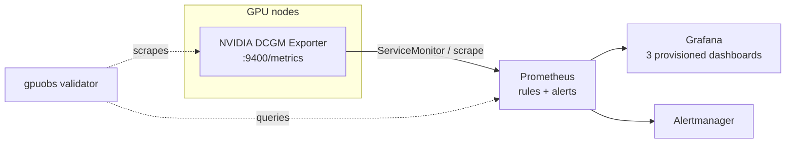

# gpu-observability-stack

A GPU telemetry and monitoring stack for Kubernetes inference infrastructure,
built on the NVIDIA DCGM Exporter, Prometheus, and Grafana. It ships the
recording rules, alerts, and dashboards an operator needs to answer "is the GPU
fleet healthy, and if not, where does it hurt?" — plus a Python validator that
checks the pipeline end to end and a CPU-only demo so you can see it work
without a GPU.

## What problem this solves

GPU inference nodes fail in ways ordinary cluster monitoring misses: an exporter
pod dies and telemetry silently vanishes, a model leaks framebuffer memory until
allocations fail, a card overheats and throttles, or an XID error marks a
failing GPU. This stack turns DCGM metrics into:

- **recording rules** that normalize raw counters (e.g. framebuffer *ratio* from
  used + free, since DCGM has no total-memory gauge);
- **alerts** for the failure modes above, tuned so they do not flap;
- **three dashboards** — fleet overview, workload diagnostics, operational
  health — with no empty panels;
- a **validator** (`gpuobs`) that distinguishes "exporter down", "metrics
  missing", "labels missing", and "all healthy" so you are not guessing.

## Architecture



The GPU Operator (from `gpu-kubernetes-platform`) owns and deploys the DCGM
Exporter; this repository owns everything downstream of the exporter's
`/metrics` endpoint. That ownership split is deliberate — see
[docs/adr/0001-dcgm-exporter-ownership.md](docs/adr/0001-dcgm-exporter-ownership.md).

## Why these technologies

- **DCGM Exporter** is NVIDIA's supported source of GPU telemetry; re-deriving
  these metrics any other way would be less accurate and unsupported.
- **Prometheus + Grafana** are the de-facto Kubernetes monitoring stack; this
  repo configures the upstream **kube-prometheus-stack** chart rather than
  reinventing it.
- **Python + prometheus-client** for the validator: the official client library
  parses exposition text and query responses correctly, and the validator logic
  stays pure and unit-tested.

## Repository layout

| Path | Contents |
| --- | --- |
| `prometheus/rules/` | recording and alert rules |
| `prometheus/servicemonitor.yaml`, `scrape-config.yaml` | target discovery (Operator and plain Prometheus) |
| `dashboards/` | three Grafana dashboard JSON files |
| `grafana/provisioning/` | datasource + dashboard providers |
| `helm/` | kube-prometheus-stack values overlay |
| `src/gpuobs/` | the `gpuobs` validation CLI |
| `examples/` | CPU-only demo: synthetic exporter + docker-compose |
| `scripts/` | static validation and demo launchers |
| `docs/` | metrics reference, architecture, runbooks, ADRs, evidence |

## Prerequisites

- Python 3.10+ for the validator (CI runs 3.10 and 3.12).
- Docker (optional) for the local demo.
- A Kubernetes cluster with the NVIDIA GPU Operator (and thus DCGM Exporter) for
  a real deployment.

## Installation

```bash
python -m venv .venv && source .venv/bin/activate
pip install -e '.[dev]'
```

This installs the `gpuobs` command.

## Working examples

### Local demo (no GPU required)

```bash
docker compose -f examples/docker-compose.yaml up
# Grafana:    http://localhost:3000  (admin / admin)
# Prometheus: http://localhost:9090
```

This runs a **synthetic** DCGM exporter (clearly labeled `synthetic="true"` on
every series — it is not real telemetry), scraped by Prometheus under the same
`dcgm-exporter` job name a real deployment uses, with the real rules and
dashboards loaded. Validate it:

```bash
gpuobs check-prometheus --url http://localhost:9090 --job dcgm-exporter
```

### Validate a real deployment

```bash
# Scrape a DCGM exporter directly (checks metric families and pod labels).
gpuobs check-exporter --url http://<dcgm-exporter>:9400/metrics

# Or go through Prometheus (connectivity + scrape health + metric presence).
gpuobs check-prometheus --url http://<prometheus>:9090 --job dcgm-exporter -o json
```

### Deploy the monitoring config

```bash
helm repo add prometheus-community https://prometheus-community.github.io/helm-charts
helm install kube-prometheus-stack prometheus-community/kube-prometheus-stack \
  -n monitoring --create-namespace \
  -f helm/kube-prometheus-stack-values.yaml
kubectl apply -f prometheus/servicemonitor.yaml
```

## Validation

```bash
ruff check src tests     # lint
mypy                     # strict type check
pytest -q                # parser, checks, rule/dashboard validation, CLI
./scripts/validate.sh    # gpuobs rule+dashboard checks (+ promtool if present)
```

The test suite validates the *shipped* rules and dashboards (not just that files
exist): every alert must carry a severity and annotations, and every dashboard
panel must query a known metric — guarding against empty or misleading panels.
See [docs/evidence.md](docs/evidence.md).

## Metrics

Only metrics present in supported DCGM Exporter releases are used. GPU memory
*capacity* is derived as `FB_USED + FB_FREE` because DCGM does not publish a
total-framebuffer gauge. Pod/namespace labels appear only when the exporter has
Kubernetes pod mapping enabled. Full reference:
[docs/metrics.md](docs/metrics.md).

## Troubleshooting

- **`check-prometheus` reports no `up` series** — the ServiceMonitor/scrape job
  name does not match `dcgm-exporter`, or the exporter Service labels do not
  match the selector in `prometheus/servicemonitor.yaml`.
- **Workload dashboards are empty** — the exporter is not mapping metrics to
  pods; `check-exporter` reports this as a `kube-labels` warning.
- **`GPUTelemetryMissing` firing on a CPU cluster** — expected; there are no GPU
  nodes. Scope the alert to clusters that should have GPUs.

Operational responses for each alert are in [docs/runbooks.md](docs/runbooks.md).

## Security

The validator makes outbound HTTP GETs to endpoints you specify, with timeouts
and bounded retries, and refuses non-HTTP(S) URLs. It needs no credentials and
stores nothing. CI uses least-privilege permissions and gitleaks secret
scanning. See [SECURITY.md](SECURITY.md).

## Architectural limitations

- Dashboards and alerts assume DCGM Exporter metric names; a different exporter
  needs different queries.
- Memory is tracked as framebuffer used/free, not per-process attribution
  (DCGM does not expose that in the default set).
- The demo uses synthetic data; it validates configuration wiring, **not** real
  hardware behavior.
- Real GPU/hardware validation was not performed (no GPU available); see
  [docs/evidence.md](docs/evidence.md).

## Related repositories

- [gpu-kubernetes-platform](https://github.com/jedi132000/gpu-kubernetes-platform)
  — provisions the cluster and the GPU Operator that deploys the DCGM Exporter
  this stack consumes.
- [gpu-scheduler-capacity-lab](https://github.com/jedi132000/gpu-scheduler-capacity-lab)
  — offline capacity planning for the same fleet.

## License

Apache-2.0. See [LICENSE](LICENSE).
