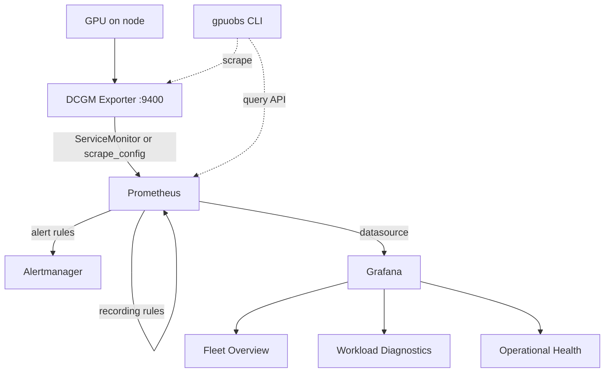
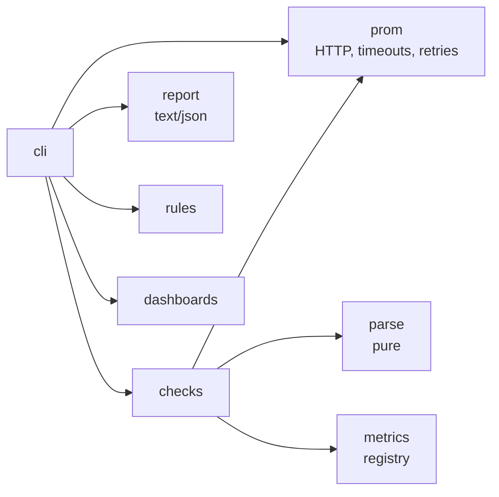

# Architecture

## Data flow

## Ownership boundary

| Concern | Owner |
| --- | --- |
| GPU driver, device plugin, DCGM Exporter deployment | `gpu-kubernetes-platform` (GPU Operator) |
| Scrape/discovery of the exporter | this repo (`prometheus/`) |
| Recording rules, alerts | this repo (`prometheus/rules/`) |
| Dashboards + provisioning | this repo (`dashboards/`, `grafana/`) |
| Prometheus/Grafana lifecycle | upstream kube-prometheus-stack chart (`helm/`) |
| Pipeline validation | this repo (`src/gpuobs/`) |

## Validator internals

The `gpuobs` package keeps I/O at the edges so the logic is testable offline:

`parse`, `metrics`, `rules`, and `dashboards` are pure (no network); only `prom`
touches the network, and its fetch function is injectable, which is how the
checks are unit-tested against fixed payloads.
